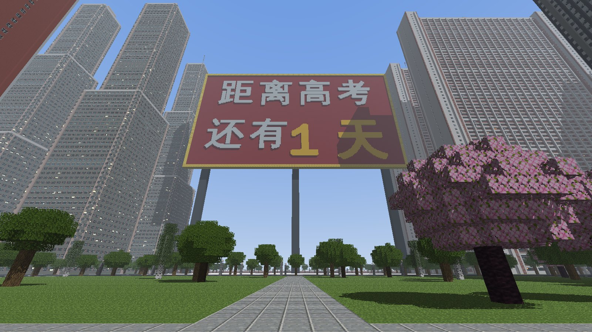
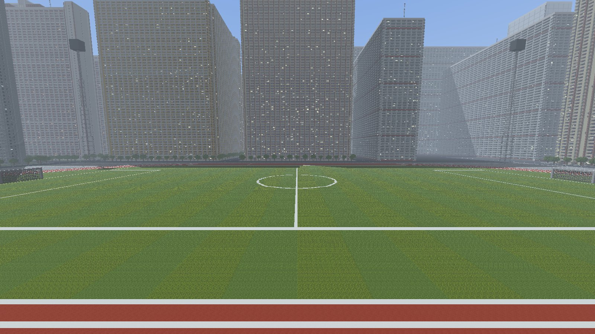
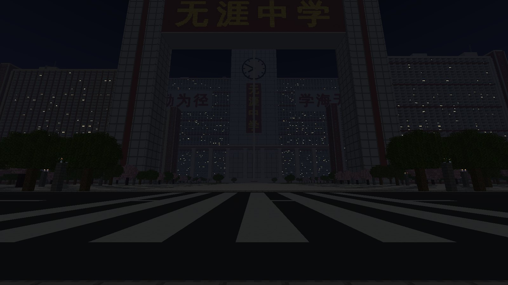

# 无涯中学 · 巨物恐惧症风格的超大型 Minecraft 学校地图

> 学海无涯，校园也无涯。

一所大到看不见尽头的高中：几百栋一模一样的高大教学楼，每栋都有八十多层、上千间教室；一栋横贯整个校园的教学楼，两头都没入雾里；一座比教学楼还高的校门，一根三百多格高的旗杆。窗户、外廊栏杆、空调外机、晾晒的衣服、篮球架、自行车棚都是**真实尺寸**，所以你一眼就能读出这些楼到底有多大。


| 主楼与升旗广场 | 教学楼峡谷 |
| --- | --- |
|  |  |
| **无尽长廊楼**（横贯校园 3952 格） | **高考倒计时牌** |
|  |  |
| **操场**（三倍尺寸的 400 米跑道） | **夜晚** |
|  |  |


*以上是生成器自带的光线追踪预览（使用原版方块贴图），不是游戏内截图；游戏里的光影、雾和视距会有所不同。*

## 规模

| | |
| --- | --- |
| 地图范围 | x −2048 ~ 2048，z −2048 ~ 1100（约 4.1 km × 3.1 km，12.9 km²） |
| 高度 | 地面 y = −60，楼顶最高到 y = 319（世界高度上限），最高的楼 82 层 |
| 建筑 | 约 450 栋大楼：198 栋教学楼、122 栋宿舍楼、64 座塔楼、29 座回字形教学楼、25 座实验楼，外加主楼、图书馆、体育馆、食堂、天文台…… |
| 连廊 | 735 条空中连廊连接各栋教学楼 |
| 小尺度参照物 | 12600 棵树、3266 盏路灯、108 个篮球架、98 个自行车棚、297 家校门外的小店 |
| 方块数 | 地面以上约 1.75 亿个方块 |
| 存档大小 | 压缩包 33 MB，解压后 235 MB |

## 安装

1. 下载 [`dist/无涯中学_存档.zip`](../dist/无涯中学_存档.zip)，解压后把里面的 `WuyaHighSchool` 文件夹放进 `.minecraft/saves/`（游戏的世界列表里显示为「无涯中学」）。
2. 用 **Java 版 1.20.1 或更新版本** 打开（已在 1.20.1、1.21.1、26.3 的原版服务器上加载测试过）。用比 1.20.1 新的版本打开时，游戏会提示「这个世界是用旧版本保存的」，点「继续」即可，游戏会自动升级存档。
3. 默认是创造模式、和平难度、开启作弊，时间固定在早晨，关闭了天气变化和生物生成。

服务器使用：把 `WuyaHighSchool` 文件夹改名为 `world`（或在 `server.properties` 里把 `level-name` 设为 `WuyaHighSchool`）放到服务端目录即可。

### 建议设置

- **渲染距离 16～32 区块**。距离越远，楼越像从雾里长出来；渲染距离低于 12 时，从出生点看不到主楼。
- 楼都非常高，建议装 **Sodium**（或 Embeddium 等同类优化模组）提升帧数。
- 想看到雾外的整片校园，可以装 **Distant Horizons**（远景 LOD 模组）：校园会一直铺到地平线。
- 视野（FOV）调到 70～80，用低一点的视角走路，巨物感最强。

## 游戏内指令

存档里带了一个小数据包，进入世界会提示：

```
/function wuya:help          列出全部指令
/function wuya:tp/gate       校门外（出生点）
/function wuya:tp/plaza      升旗广场
/function wuya:tp/steps      主楼台阶与巨柱
/function wuya:tp/canyon     东侧教学楼峡谷
/function wuya:tp/corridor   站在一栋教学楼的外廊里
/function wuya:tp/clock      钟楼正前方半空（创造模式请双击空格飞行）
/function wuya:tp/roof       主楼屋顶
/function wuya:tp/playground 操场看台
/function wuya:tp/library    图书馆柱廊
/function wuya:tp/endless    无尽长廊楼
/function wuya:tp/countdown  高考倒计时牌
/function wuya:tp/sky        高空俯瞰
/function wuya:tiny          把自己缩小到十分之一（需要 1.20.5+），所有东西看起来大十倍
/function wuya:normal        恢复正常大小
/function wuya:day | wuya:dusk | wuya:night   切换时间（夜里约 2% 的教室亮着灯）
```

## 地图导览

从出生点（校门外的小街，0, −60, 1065）往北走：

| 地点 | 坐标（x, z） | 说明 |
| --- | --- | --- |
| 校门外小街 | 0, 1034 ~ 1082 | 一排两三层的文具店、早餐店、奶茶店，是整张图里唯一正常大小的房子 |
| 校门 | 0, 880 | 两根 225 格高的门柱，横梁上是金色的「无涯中学」，背面是「厚德博学」 |
| 升旗广场 | 0, 770 | 334 格高的旗杆和会飘的校旗 |
| 教学楼峡谷 | 中轴两侧，z 652 ~ 872 | 一排排外廊式教学楼，楼梯间上竖写着楼名（明德楼、致远楼、博学楼……） |
| 主楼 | x −544 ~ 544，z 304 ~ 600 | 1088 格宽的梳子形大楼，正面写着「书山有路勤为径 / 学海无涯苦作舟」；72 格高的巨柱门廊；中间的钟楼顶到世界高度上限，钟停在 7 点 50 分 |
| 图书馆 | 0, 193 | 200 格高的柱廊 |
| 操场 | 672, 122 | 3 倍尺寸的 400 米跑道和足球场、看台、四座灯塔 |
| 地球仪花园 | 0, −272 | 地球仪雕塑、池塘、樱花 |
| 无尽长廊楼 | x −1976 ~ 1976，z −944 | 一栋 3952 格长、76 层高的教学楼，正面每一段一个大字：「学而时习之，不亦说乎？有朋自远方来……」；道路从底层的门洞穿过 |
| 体育馆 | −448, 176 / 0, −1392 | 筒形拱顶 |
| 食堂 | −448, −48 / 1344, −496 | |
| 天文台 | −896, −1392 / 1568, −1840 | |
| 高考倒计时牌 | 0, −1840 | 260 格宽：「距离高考 还有 1 天」 |
| 篮球场 | −946, 762 | 54 个标准尺寸的篮球场 |

其余每一块 192 × 192 的地块随机是外廊式教学楼群（带空中连廊）、回字形教学楼、塔楼、宿舍楼（阳台上晾着衣服）、实验楼或花园。离校门越远，楼越高。

## 已知限制

- 只做了建筑外观：楼的内部是空的（外墙有两三格厚，窗户后面是深色的「室内」方块）。外廊是可以走进去的。
- 为了让存档在 1.20.1 ~ 26.x 都能直接打开，没有用会自动连接的方块（玻璃板、栅栏），栏杆和天线用的是不连接的铁栏杆柱。
- 本存档没有在游戏客户端里实测过。验证方式：在 1.20.1、1.21.1、26.3 的原版服务器上加载整张地图，每个区域文件随机抽取方块与生成器的结果逐个比对（68/68 一致），并在 26.3 上一次加载 1024 个区块、保存，没有报错；数据包的每个函数都在这三个版本上执行过。如果在游戏里遇到问题，请把报错告诉我。

## 重新生成 / 修改

全部建筑由 `megaschool/` 里的 Python 代码生成（只需要 numpy 和 Pillow，以及一个中文字体用于写大字；Linux 上是 `fonts-wqy-zenhei`）：

```bash
pip install numpy pillow
python3 megaschool/generate.py --zip dist/无涯中学_存档.zip     # 约 30 秒，输出到 build/world/WuyaHighSchool
```

预览图与服务器测试（可选）：

```bash
# 预览渲染需要原版方块贴图：把客户端 jar 里的 assets/minecraft/textures/block 解压到 build/tex/
python3 megaschool/preview.py build/preview gate avenue endless
# 用原版服务器验证：把 server-<版本>.jar 放进 build/servers/（26.x 还需要 JDK 25，放在 build/servers/jdk-25*/）
python3 megaschool/verify.py build/world/WuyaHighSchool 1.21.1
```

| 文件 | 内容 |
| --- | --- |
| `campus.py` | 整个校园的布局：地块网格、中轴、校门外小街、操场、长廊楼、倒计时牌 |
| `buildings.py` | 教学楼（外廊 + 楼梯间 + 楼名）、回字形楼、塔楼、宿舍、实验楼、体育馆、食堂、连廊、树、路灯等 |
| `landmarks.py` | 校门、旗杆、主楼与钟、门廊、台阶、看台、灯塔、地球仪、图书馆 |
| `facades.py` | 立面模块：外廊、窗墙、带形窗、玻璃幕墙、阳台、楼梯间，以及立面大字 |
| `schemes.py` | 8 套配色（白墙红带、米黄砖红、蓝白、灰色现代、红砖、清水混凝土、土黄、白瓷砖） |
| `anvil.py` / `nbt.py` / `level.py` | 直接写出 Java 版存档（区块按 1.20.1 格式写入，新版本打开时自动升级） |
| `datapack.py` | 存档内置的数据包（传送点、昼夜、小人模式） |
| `render.py` / `textures.py` / `preview.py` | 预览用的体素光线追踪器 |
| `servertest.py` / `verify.py` | 用原版服务器加载存档并比对方块 |

想改学校名字、标语、楼名：分别在 `landmarks.py` 的 `gate()`、`main_building()` 和 `campus.py` 的 `NAMES` / `MOTTOS` / `SIGNS` 里。想要更大的地图：改 `campus.py` 里的 `HALF`（地块会自动铺满）。
