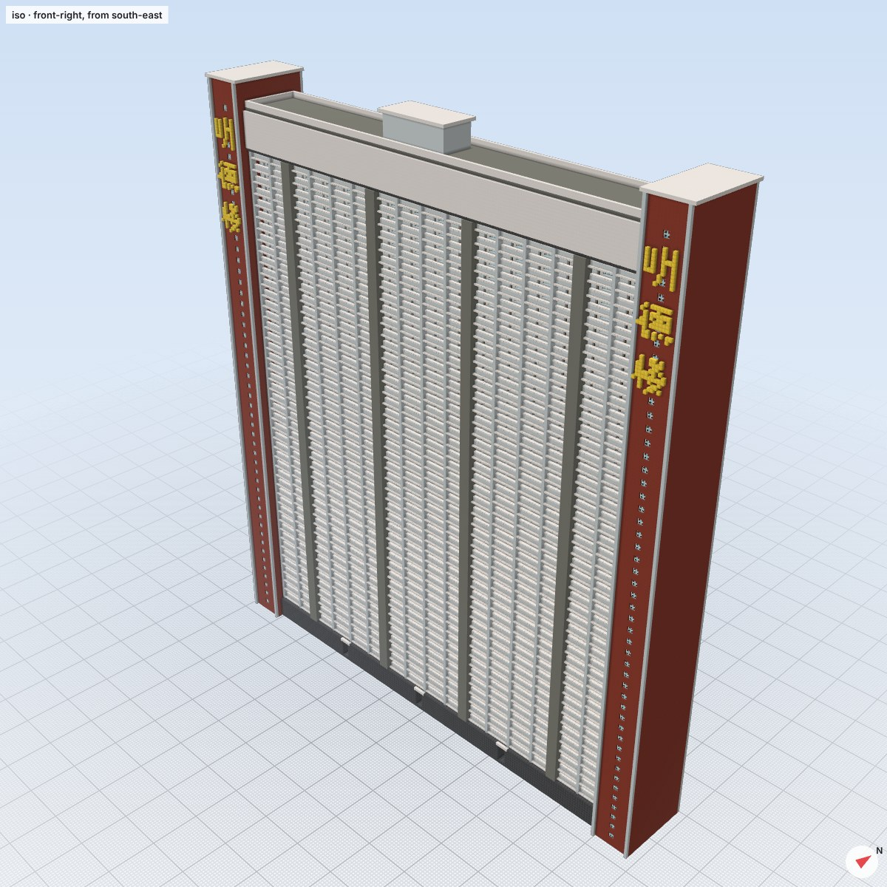

# 无涯中学 · 巨物恐惧症风格的超大型 Minecraft 学校地图

> 学海无涯，校园也无涯。

**黄昏版。** 太阳刚落到校园西边，天边还剩一道橙红，几百栋八十多层的教学楼已经暗成剪影，楼里成片的教室亮着晚自习的灯。

一所大到看不见尽头的高中。教学楼上没有任何标语或口号，只靠建筑本身压人：
- 每隔 40 格一根贯通整栋楼的巨柱。
- 楼顶是厚重的檐口，下面压着一道深色阴影线。
- 底层是深色石材基座，开着高大的门洞。
- 一栋横贯整个校园的长廊楼，两头都没入暮色里。

这一版主要做的是巨型教学楼以外的**校园设施和外景**：
- 湖心亭、拱桥和垂柳围起的校园湖。
- 50 米室外游泳池（水下灯亮着）、网球场、乒乓球场。
- 巨柱环绕的大礼堂，三座玻璃筒拱温室。
- 风雨连廊、喷泉，校门外的校车停车场、停车场和公交站。
- 一座 320 格高的巨型水塔。

这些设施连同立面模块、树木、路灯、小店，都是用 **[VibeSchem](https://github.com/SimoneRecchia/minecraft-schematic-lab)** 设计和编译的。窗户、栏杆、长椅、篮球架、校车都是**真实尺寸**，衬得那些楼越发巨大。


| 校园湖（湖心亭、九曲栈桥，对岸是大礼堂） | 游泳池与网球场（跳台上看） |
| --- | --- |
|  |  |
| **大礼堂** | **植物园温室** |
|  |  |
| **校门外的校车停车场** | **巨型水塔** |
|  |  |
| **主楼与升旗广场、风雨连廊** | **校门外的小街与公交站** |
|  |  |
| **教学楼峡谷** | **无尽长廊楼** |
|  |  |


| 入夜（`/function wuya:night`） | VibeSchem 里的单栋教学楼（可导出） |
| --- | --- |
|  |  |

*以上是生成器自带的光线追踪预览（原版方块贴图，黄昏光照与灯光是近似模拟），不是游戏内截图；游戏里的天空、光影、雾和视距会有所不同。*

## 规模

| | |
| --- | --- |
| 地图范围 | x −2048 ~ 2048，z −2048 ~ 1100（约 4.1 km × 3.1 km，12.9 km²） |
| 高度 | 地面 y = −60，楼顶最高到 y = 319（世界高度上限），最高的楼 82 层 |
| 建筑 | 约 450 栋大楼：177 栋教学楼、117 栋宿舍楼、76 座塔楼、38 座回字形教学楼、16 座实验楼，外加主楼、长廊楼、图书馆、大礼堂、体育馆、食堂、天文台、水塔…… |
| 连廊 | 639 条空中连廊连接各栋教学楼，中轴两侧各一条 180 格长的风雨连廊 |
| 校园设施 | 校园湖、50 米游泳池、4 片网球场、24 张乒乓球台、健身器材、大礼堂、3 座温室、喷泉、校车停车场（约 70 辆校车）、停车场（约 200 辆车）、公交站、巨型水塔 |
| 小尺度参照物 | 12496 棵树、3202 盏路灯、108 个篮球架、94 个自行车棚、58 张长椅、324 家校门外的小店 |
| 方块数 | 地面以上约 1.96 亿个方块 |
| 存档大小 | 压缩包 40 MB，解压后 236 MB |

## 安装

1. 下载 [`dist/无涯中学_存档.zip`](../dist/无涯中学_存档.zip)，解压后把里面的 `WuyaHighSchool` 文件夹放进 `.minecraft/saves/`（游戏的世界列表里显示为「无涯中学」）。
2. 用 **Java 版 1.20.1 或更新版本** 打开（已在 1.20.1、1.21.1、26.3 的原版服务器上加载测试过）。用比 1.20.1 新的版本打开时，游戏会提示「这个世界是用旧版本保存的」，点「继续」即可，游戏会自动升级存档。
3. 默认是创造模式、和平难度、开启作弊，**时间固定在黄昏**（12700，太阳刚落），关闭了天气变化和生物生成。想看白天用 `/function wuya:day`。

服务器使用：把 `WuyaHighSchool` 文件夹改名为 `world`（或在 `server.properties` 里把 `level-name` 设为 `WuyaHighSchool`）放到服务端目录即可。

### 只要一栋楼？

`dist/` 里还有两份用 VibeSchem 导出的单栋建筑原理图，可以粘贴到你自己的世界里（1.20.1+）：

| 文件 | 内容 |
| --- | --- |
| `无涯中学_教学楼.schem` / `.litematic` | 50 层外廊式教学楼「明德楼」，190 × 210 × 28：巨柱、厚重檐口、深色基座 |
| `无涯中学_宿舍楼.schem` / `.litematic` | 30 层宿舍楼，150 × 123 × 16，阳台上晾着衣服 |

WorldEdit：放进 `config/worldedit/schematics/`，`//schem load 无涯中学_教学楼` 然后 `//paste`。Litematica：放进 `.minecraft/schematics/`。

### 建议设置

- **渲染距离 16～32 区块**。距离越远，楼越像从雾里长出来；渲染距离低于 12 时，从出生点看不到主楼。
- 楼都非常高，建议装 **Sodium**（或 Embeddium 等同类优化模组）提升帧数。
- 想看到雾外的整片校园，可以装 **Distant Horizons**（远景 LOD 模组）：校园会一直铺到地平线。
- 视野（FOV）调到 70～80，用低一点的视角走路，巨物感最强。
- 黄昏版建议把「亮度」调到中间附近：太亮会冲淡暮色，太暗则看不清楼下的设施。光影包（如 Complementary）能把夕阳和灯光渲染得更好。

## 游戏内指令

存档里带了一个小数据包，进入世界会提示：

```
/function wuya:help          列出全部指令
/function wuya:tp/gate       校门外（出生点）
/function wuya:tp/plaza      升旗广场
/function wuya:tp/steps      主楼台阶与巨柱
/function wuya:tp/canyon     东侧教学楼峡谷
/function wuya:tp/corridor   站在一栋教学楼的外廊里
/function wuya:tp/clock      钟楼正前方半空（创造模式请双击空格飞行）
/function wuya:tp/roof       主楼屋顶
/function wuya:tp/playground 操场看台
/function wuya:tp/library    图书馆柱廊
/function wuya:tp/endless    无尽长廊楼
/function wuya:tp/watertower 巨型水塔
/function wuya:tp/lake       校园湖（湖心亭、拱桥）
/function wuya:tp/pool       游泳池跳台
/function wuya:tp/auditorium 大礼堂
/function wuya:tp/greenhouse 植物园温室
/function wuya:tp/buses      校车停车场
/function wuya:tp/sky        高空俯瞰
/function wuya:tiny          把自己缩小到十分之一（需要 1.20.5+），所有东西看起来大十倍
/function wuya:normal        恢复正常大小
/function wuya:day | wuya:dusk | wuya:night   切换时间（默认黄昏；约五分之一的教室亮着灯）
```

## 地图导览

从出生点（校门外的小街，0, −60, 1065）往北走：

| 地点 | 坐标（x, z） | 说明 |
| --- | --- | --- |
| 校门外小街 | 0, 1034 ~ 1082 | 一排两三层的小店和一个公交站，是整张图里唯一正常大小的房子 |
| 校车停车场 / 停车场 | −550, 945 / 550, 945 | 校门外两侧：一排排黄色校车（车灯亮着）和小汽车 |
| 喷泉 | 0, 954 | 校门外广场中央，水下灯 |
| 校门 | 0, 880 | 两根 225 格高的门柱，横梁上是金色的「无涯中学」，背面是「厚德博学」 |
| 升旗广场 | 0, 770 | 334 格高的旗杆和会飘的校旗；中轴两侧是挂着灯笼的风雨连廊 |
| 校园湖 | −250, 762 | 湖心亭、九曲栈桥、通往小岛的拱桥、垂柳、荷叶、环湖步道和路灯 |
| 游泳池 / 网球场 | 250, 762 | 50 米泳池（水下灯、跳台、看台、更衣室）、4 片网球场、乒乓球场、单双杠 |
| 大礼堂 | −482, 762 | 深色基座上 12 根 42 格高的巨柱，柱间狭长高窗透出灯光，厚重的四坡屋顶 |
| 植物园 | 482, 762 | 三座玻璃筒拱温室（里面有棕榈、樱花和花丛）、绿篱花园、水池 |
| 教学楼峡谷 | 设施以外的中轴两侧，z 652 ~ 872 | 一排排外廊式教学楼，楼梯间上竖写着楼名（明德楼、致远楼、博学楼……） |
| 主楼 | x −544 ~ 544，z 304 ~ 600 | 1088 格宽的梳子形大楼，正面是一排排巨柱和深色基座；72 格高的巨柱门廊；中间的钟楼顶到世界高度上限，钟停在 7 点 50 分 |
| 图书馆 | 0, 193 | 200 格高的柱廊 |
| 操场 | 672, 122 | 3 倍尺寸的 400 米跑道和足球场、看台、四座灯塔 |
| 地球仪花园 | 0, −272 | 地球仪雕塑、池塘、樱花 |
| 无尽长廊楼 | x −1976 ~ 1976，z −944 | 一栋 3952 格长、76 层高的教学楼，巨柱一根接一根排到暮色里；道路从底层的门洞穿过 |
| 体育馆 | −448, 176 / 0, −1392 | 筒形拱顶 |
| 食堂 | −448, −48 / 1344, −496 | |
| 天文台 | −896, −1392 / 1568, −1840 | |
| 巨型水塔 | 0, −1840 | 八根塔腿托着 70 格宽的水箱，顶到 y = 260，顶上亮着警示灯 |
| 篮球场 | −946, 762 | 54 个标准尺寸的篮球场 |

其余每一块 192 × 192 的地块随机是外廊式教学楼群（带空中连廊）、回字形教学楼、塔楼、宿舍楼（阳台上晾着衣服）、实验楼或花园。离校门越远，楼越高。

## 用 VibeSchem 做了什么

[VibeSchem](https://github.com/SimoneRecchia/minecraft-schematic-lab) 是给 Claude 用的 Minecraft 建筑工具：用 BuildSpec（JSON）描述建筑，它按指定版本（这里是 1.20.1）严格校验每个方块，并像游戏放置方块时一样自动设置方块状态（玻璃板和墙互相连接、门补上上半、台阶自动转角、旋转后的副本连朝向一起旋转），再用原版贴图和方块模型渲染出来，导出 `.schem` / `.litematic` 等格式。

整个校园有约 50 亿格，超出单个 VibeSchem 建筑的上限（约 1 亿格），所以分工是：

1. **立面模块**：外廊、窗墙、阳台、带形窗、玻璃幕墙五种立面，每种只设计「一层 × 一个开间」，按 VibeSchem 指南里的「三层进深」做：壁柱和楼层线凸出 1 格、墙面居中、玻璃板内凹 1 格，每条水平线下面用半砖做阴影线。每个模块 × 8 套配色 × 4 个朝向在 VibeSchem 里按 3 × 3 平铺编译，取中间那一块，这样边缘的玻璃板正好按平铺后的邻居连接。生成器再把这些模块铺满全部约 460 栋楼，并在上面叠加强调色带、亮灯的教室、空调外机、晾晒的衣服和立面大字。
2. **校园设施和外景**（黄昏版新增，见 `facilities.py`）：校园湖、游泳池与网球场、大礼堂、植物园温室、风雨连廊、喷泉、公交站、校车停车场、停车场、巨型水塔，每个都是一份完整的 BuildSpec，在 VibeSchem 里编译、渲染、按它的「批评—修改」流程改过一轮，再按地块放进地图。设计时特意照顾了黄昏：路灯、灯笼、水下灯、亮着的车灯和礼堂高窗。
3. **小东西**：16 种程序生成的树（橡树、大橡树、白桦、樱花、灌木）、路灯、长椅、篮球架、自行车棚、门卫室和 10 种临街小店，都是完整的 VibeSchem 建筑，按真实尺寸放进地图。
4. **单栋导出**：用同样的模块在 VibeSchem 里拼出一栋完整的教学楼和宿舍楼，由 VibeSchem 导出 `.schem` / `.litematic`（见上文）。

编译结果缓存在 `megaschool/vibeschem_cache.json.gz`（350 kB，已提交），所以重新生成地图**不需要**安装 VibeSchem。所有 BuildSpec 都在 `megaschool/vibeschem_specs/` 里，可以直接交给 VibeSchem 打开、修改、渲染。改了模块想重新编译：先按 VibeSchem 的说明启动它的本地服务器（默认 `http://127.0.0.1:8765`，可用 `VIBESCHEM_URL` 指定），然后

```bash
python3 megaschool/vibeschem.py sync                # 重新编译全部模块、设施和小东西，写入缓存
python3 megaschool/vibeschem.py export dist/        # 重新导出单栋教学楼 / 宿舍楼
```

## 已知限制

- 只做了建筑外观：楼的内部是空的（外墙有几格厚，窗户后面是深色的「室内」方块）。外廊是可以走进去的。
- 楼梯间、主楼钟楼、校门、旗杆、操场看台等大型地标，以及教学楼上的巨柱、檐口和基座，仍由生成器直接用方块拼出，没有经过 VibeSchem。
- 地面只有 3 层（超平坦），所以湖和泳池只有 2 格深。
- 本存档没有在游戏客户端里实测过。验证方式：在 1.20.1、1.21.1、26.3 的原版服务器上加载整张地图，逐个比对方块（随机抽样 114/114 一致，其中 50 个是带方块状态的方块：玻璃板、门、台阶、半砖、灯笼等，比对到每一个属性；新设施里另抽 100 个方块，在 1.20.1 和 26.3 上 100/100 一致；两个版本都确认时间是 12700）；之前的版本还在 26.3 上一次加载 1024 个区块、保存，没有报错；数据包的每个函数都在这三个版本上执行过。如果在游戏里遇到问题，请把报错告诉我。

## 重新生成 / 修改

全部建筑由 `megaschool/` 里的 Python 代码生成（只需要 numpy 和 Pillow，以及一个中文字体用于写大字；Linux 上是 `fonts-wqy-zenhei`）：

```bash
pip install numpy pillow
python3 megaschool/generate.py --zip dist/无涯中学_存档.zip     # 约 30 秒，输出到 build/world/WuyaHighSchool
```

预览图与服务器测试（可选）：

```bash
# 预览渲染需要原版方块贴图：把客户端 jar 里的 assets/minecraft/textures/block 解压到 build/tex/
python3 megaschool/preview.py build/preview gate avenue endless
# 用原版服务器验证：把 server-<版本>.jar 放进 build/servers/（26.x 还需要 JDK 25，放在 build/servers/jdk-25*/）
python3 megaschool/verify.py build/world/WuyaHighSchool 1.21.1
```

| 文件 | 内容 |
| --- | --- |
| `campus.py` | 整个校园的布局：地块网格、中轴、校门外小街、设施地块、操场、长廊楼、水塔 |
| `buildings.py` | 教学楼（外廊 + 楼梯间 + 楼名）、回字形楼、塔楼、宿舍、实验楼、体育馆、食堂、连廊、树、路灯等 |
| `landmarks.py` | 校门、旗杆、主楼与钟、门廊、台阶、看台、灯塔、地球仪、图书馆 |
| `facades.py` | 把立面模块铺满墙面，叠加色带、亮灯、空调、晾衣和立面大字（没有 VibeSchem 缓存时用内置的简化模块） |
| `vibeschem.py` / `vibeschem_specs/` / `vibeschem_cache.json.gz` | VibeSchem 桥接：模块和小东西的 BuildSpec、编译、缓存、单栋导出（`vibeschem_specs/fac_*.png` 是 VibeSchem 渲染的设施图） |
| `facilities.py` | 校园设施与外景的 BuildSpec |
| `schemes.py` | 8 套配色（白墙红带、米黄砖红、蓝白、灰色现代、红砖、清水混凝土、土黄、白瓷砖） |
| `anvil.py` / `nbt.py` / `level.py` | 直接写出 Java 版存档（区块按 1.20.1 格式写入，新版本打开时自动升级） |
| `datapack.py` | 存档内置的数据包（传送点、昼夜、小人模式） |
| `render.py` / `textures.py` / `preview.py` | 预览用的体素光线追踪器（黄昏天空与光照、近似的方块光；支持半砖、玻璃板、门、活板门等非完整方块） |
| `servertest.py` / `verify.py` | 用原版服务器加载存档并比对方块 |

想改学校名字、楼名：分别在 `landmarks.py` 的 `gate()` 和 `campus.py` 的 `NAMES` 里；巨柱、檐口、基座在 `facades.py` 的 `monument()`；黄昏时间在 `generate.py` 的 `DUSK`。想要更大的地图：改 `campus.py` 里的 `HALF`（地块会自动铺满）。
